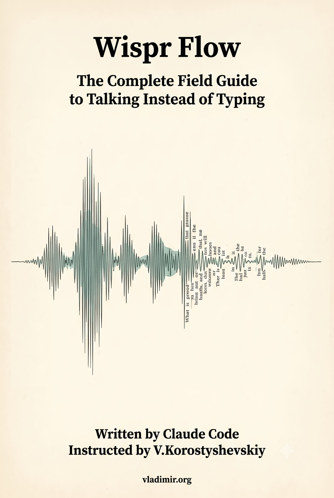

# Wispr Flow: The Complete Field Guide to Talking Instead of Typing

*Last updated: June 2026.*

A practitioner reference for Wispr Flow, the voice dictation app that works in any text field on any platform. 24 chapters covering the dictation model, platform-specific setup for Windows, macOS, iPhone, and Android, the cleanup engine, command mode, context awareness, writing styles, snippets, multilingual dictation, coding workflows, privacy and security, teams and enterprise administration, and troubleshooting.

The editorial position is this: Flow is not a transcriber, it is a rewriter. A language model sits between the microphone and the screen and quietly fixes the speaker on the way through. Everything Flow does well and everything it does badly starts there. The book treats each feature as an engineering design space with trade-offs rather than a marketing bullet point with a checkmark.

## Read the book

- **EPUB** (for e-readers): [download](https://github.com/vkorost/wispr-flow-field-guide/releases/latest/download/Wispr_Flow.epub)
- **PDF**: [download](https://github.com/vkorost/wispr-flow-field-guide/releases/latest/download/Wispr_Flow.pdf)
- **Per-chapter Markdown**: see the [Table of Contents](#table-of-contents) below.

Both formats are attached to the [latest release](https://github.com/vkorost/wispr-flow-field-guide/releases/latest) and always point at the current revision.

## Why this exists

I wanted a single, continuous read that covered the entire surface area of Wispr Flow, from the dictation model to enterprise admin controls. The official help center is comprehensive but distributed across more than a hundred separate articles, each answering one question, none meant to be read end to end. Anyone who wants to actually understand the tool has to click, read, click, read, and assemble the picture alone. That is a poor way to learn anything nontrivial.

This book is the assembly. One continuous read, the kind that survives on an e-reader on a couch, instead of a hundred open browser tabs. It is built for the human who is a week into Flow, newly on a paid plan, and wanting the whole shape of the thing in one sitting rather than a scavenger hunt through a support site.

## How it was made

I used [site2vault](https://github.com/vkorost/site2vault), my own documentation-to-Obsidian converter, to pull down the Wispr Flow help center into a structured, searchable local vault with manifests for section-level reads.

The research corpus spans:

| Source | Type | Coverage |
|--------|------|----------|
| docs.wisprflow.ai | site2vault | Full help center (100+ articles) |
| Independent research reports | LLM-assisted synthesis | Cross-referenced against help center |

The book itself was assembled with Claude using techniques described in [weekend-diy-book](https://github.com/vkorost/weekend-diy-book): style condensation, per-chapter assembly under explicit constraints, dedup, multi-pass review, editorial revision, and final manuscript generation (EPUB and PDF), orchestrated as a multi-phase, multi-agent pipeline.

## The 24 Chapters

The book is organized in five sections:

- **Foundations** (Chs 1-2): What Flow is, who it is for, how the dictation model works across all platforms, session mechanics, the hotkey-to-text pipeline, and the Rewrite Pass that separates Flow from a raw transcriber.
- **Platform Guides** (Chs 3-6): Self-contained chapters for Windows, macOS, iPhone, and Android. Each covers installation, permissions, platform-specific features, and known limitations. A Windows reader never has to wade through the iPhone keyboard; an Android reader can skip the Mac permission dance.
- **The Engine Room** (Chs 7-14): The cleanup engine, command mode and AI transforms, context awareness, custom dictionary, snippets, writing styles, multilingual dictation, and coding workflows. How Flow processes, formats, and adapts your speech.
- **Workflows and Daily Use** (Chs 15-22): Email and messaging, notes and capture, remote and restricted environments, audio and hardware, plans and billing, sync and account management, privacy and security, and usage insights. Practical patterns for real work.
- **Administration and Recovery** (Chs 23-24): Teams and enterprise deployment, admin controls, SSO and SCIM provisioning, and a comprehensive troubleshooting guide.

Each chapter cites the official help center documentation with direct URLs in the endnotes. The documentation is the ultimate source of truth.

## Table of Contents

- [Preface](./book/chapters/00-preface.md)

**Foundations**
1. [What Flow Is](./book/chapters/01-what-flow-is.md)
2. [The Dictation Model](./book/chapters/02-the-dictation-model.md)

**Platform Guides**
3. [Windows](./book/chapters/03-windows.md)
4. [macOS](./book/chapters/04-macos.md)
5. [iPhone](./book/chapters/05-iphone.md)
6. [Android](./book/chapters/06-android.md)

**The Engine Room**
7. [The Cleanup Engine](./book/chapters/07-cleanup-engine.md)
8. [Command Mode and AI Transforms](./book/chapters/08-command-mode-transforms.md)
9. [Context Awareness](./book/chapters/09-context-awareness.md)
10. [Custom Dictionary](./book/chapters/10-dictionary.md)
11. [Snippets](./book/chapters/11-snippets.md)
12. [Writing Styles and Bulk Setup](./book/chapters/12-styles-and-bulk-setup.md)
13. [Multilingual Dictation](./book/chapters/13-multilingual.md)
14. [Coding Workflows](./book/chapters/14-coding.md)

**Workflows and Daily Use**
15. [Email and Messaging](./book/chapters/15-writing-email-messaging.md)
16. [Notes and Capture](./book/chapters/16-notes-and-capture.md)
17. [Remote and Restricted Environments](./book/chapters/17-remote-and-restricted.md)
18. [Audio and Hardware](./book/chapters/18-audio-and-hardware.md)
19. [Plans, Billing, and Limits](./book/chapters/19-plans-billing-limits.md)
20. [Sync, Account, and Devices](./book/chapters/20-sync-account-devices.md)
21. [Privacy, Security, and Data](./book/chapters/21-privacy-security-data.md)
22. [Usage and Insights](./book/chapters/22-usage-and-insights.md)

**Administration and Recovery**
23. [Teams and Enterprise](./book/chapters/23-teams-and-enterprise.md)
24. [Troubleshooting](./book/chapters/24-troubleshooting.md)

**Appendix**
- [Endnotes](./book/chapters/99-appendix-g-endnotes.md) (direct URLs to the Wispr Flow help center)

## What's in this repo

- `README.md`: this file.
- `book/`: the cover image. The compiled EPUB and PDF are attached to the [latest release](https://github.com/vkorost/wispr-flow-field-guide/releases/latest) rather than committed here.
- `book/chapters/`: the 24 chapters as individual Markdown files, plus the preface (`00-preface.md`) and the endnotes appendix (`99-appendix-g-endnotes.md`) with direct URLs to the Wispr Flow help center.
- [`LICENSE`](./LICENSE): CC BY-NC-SA 4.0 for all content.

The raw documentation vault, the assembly pipeline instructions, and the working files (style constraints, registry, reviewer reports, pipeline state) are not published. Only the book and this description are here.

## Coverage cutoff

Documentation sources were consulted through Q2 2026. Wispr Flow ships changes at roughly a monthly cadence, which means some specific number, menu path, or limit in these pages will eventually be wrong. Where a claim is sensitive to versions, it carries a date. When a screen does not match the text, trust the screen.

If you find a claim that has drifted from the current product, open an Issue.

## Scope of AI assistance

Claude was used for research synthesis, prose generation in a defined voice (Michael Lopp engineering essay style with named-pattern discipline), per-chapter assembly under explicit constraints with anti-repetition registry enforcement, and generating the endnotes apparatus. The multi-agent pipeline included a Style Agent, Grounding Agent, Registry Agent, 24 Writer Agents, 24 Fact-Trace Agents, an Endnotes Compiler, and automated fact-trace correction, all running sequentially. Editorial decisions about structure, framing, and which positions to include were mine. Fact-checking was bounded by the source corpus: the official Wispr Flow help center documentation.

## What's not in scope

This is not a getting-started tutorial. It is not a marketing overview. It is not a troubleshooting FAQ (though Chapter 24 covers troubleshooting comprehensively). The reader is assumed to have installed Flow at least once and to understand what voice dictation is. The book does not teach you to talk; it teaches you how Flow turns talking into text, where it helps, where it overreaches, and how to make it do what you actually want.

## Disclaimer

This repository is an independent, unofficial field guide. It is not produced, endorsed, sponsored, or reviewed by Wispr. "Wispr Flow" and "Flow" are trademarks of Wispr, Inc., used here for descriptive reference only. I am not employed by Wispr or any AI vendor, and the book does not represent any company's views. The analytical framework and the structural argument are original to this work. The facts are drawn from the cited public corpus.

## License

All content in this repository is licensed under **Creative Commons Attribution-NonCommercial-ShareAlike 4.0 International (CC BY-NC-SA 4.0)**. See [`LICENSE`](./LICENSE).

The prose may be shared and adapted for non-commercial purposes with attribution. Commercial reuse or redistribution of the written content (including republication as a book, course, or paid resource) is not permitted, and any derivative work must carry the same CC BY-NC-SA 4.0 license.

---

